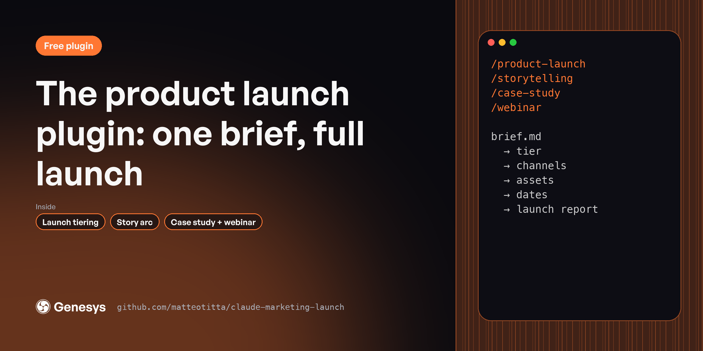

# Product launch plugin

A launch usually lives in one person's head and twelve Slack threads. These 4 skills turn one brief into a tiered plan, the story behind it, customer proof and a launch webinar. For product marketers and founders shipping in the next 60 days.

**Free, MIT licensed. Works in Claude Code, Claude.ai and Cowork.**

---

## Install

In Claude Code:

```
/plugin marketplace add matteotitta/claude-marketing-launch
/plugin install marketing-launch@claude-marketing-launch
```

From your terminal:

```bash
claude plugin marketplace add matteotitta/claude-marketing-launch
claude plugin install marketing-launch@claude-marketing-launch
```

In Claude.ai or Cowork: download [`claude-marketing-launch.zip`](https://github.com/matteotitta/claude-marketing-launch/releases/latest) and upload it under *Customize → Plugins → Upload plugin*.

---

## Skills

| Skill | What it does |
|---|---|
| `/case-study` | Turns a customer interview or win into a B2B case study with a before-and-after story, sourced metrics and verbatim quotes, ready for a web page or… |
| `/product-launch` | Plans a B2B SaaS product or feature launch from one brief. |
| `/storytelling` | Builds a narrative-driven B2B campaign from your positioning. |
| `/webinar` | Plans a B2B webinar from topic to follow-up. |

**Start here:** `/product-launch → /storytelling → /case-study → /webinar`

---

## Works best with your context

Every skill reads your context files before it writes: `context/icp/`, `context/positioning/`, `context/messaging/`, `context/brand/` and the rest. If a file is missing, the skill asks you or tells you what it's working without.

The quickest way to set those folders up is a free workspace template:

- [repo-structure-in-house](https://github.com/matteotitta/repo-structure-in-house) for one company
- [repo-structure-agency](https://github.com/matteotitta/repo-structure-agency) for agencies and consultants (swap `context/` for `clients/<client>/context/`)

---

## What the full version adds

These are free, shortened versions of skills from [Marketing Engineering University](https://maven.com/matteo-tittarelli/marketing-engineering-university-genesys-growth). The course versions add the reference material, worked examples and output templates these leave out, plus agents and hooks that chain the skills and check their own work. Week 3 of Marketing Engineering University turns launches into skills an agent can chain and check.

## More free plugins

- [Marketing context plugin](https://github.com/matteotitta/claude-marketing-context)
- [Website plugin](https://github.com/matteotitta/claude-marketing-website)
- [AEO plugin](https://github.com/matteotitta/claude-marketing-aeo)
- [LinkedIn plugin](https://github.com/matteotitta/claude-marketing-linkedin)
- [Content plugin](https://github.com/matteotitta/claude-marketing-content)
- [Build your own GTM skills](https://github.com/matteotitta/gtm-skill-template)

---

Built by [Matteo Tittarelli](https://www.linkedin.com/in/matteotittarelli/) at [Genesys Growth](https://genesysgrowth.com). MIT licensed.
